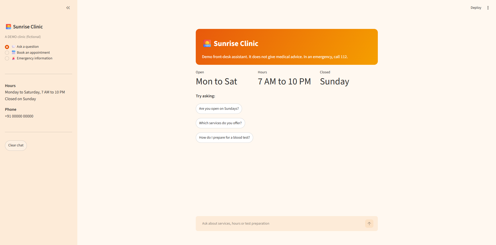
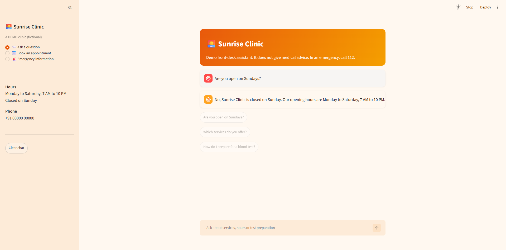

# Sunrise Clinic Front-Desk Chatbot (demo)

A demo front-desk assistant for **Sunrise Clinic, a fictional clinic**. It answers questions
about services, opening hours and test preparation, collects booking requests, and sends
emergencies to emergency services (112 in India). It never diagnoses or recommends medicines.

This is a learning project. It is not a medical product, and the clinic, phone number and
hours are invented.




## What it does
- **FAQ chat:** answers from a fixed set of clinic facts, using the Gemini API
- **Booking:** a form checked in Python (name, 10-digit phone, date within 30 days, not
  Sunday), saved to a local `bookings.csv`
- **Emergency:** a fixed message shown by code, before the model is ever called
- Runs as a Streamlit web page (`app.py`) or in the terminal (`chatbot.py`)

## Design decisions
- **The model is told only what it may say.** The system prompt holds the clinic facts and
  rules. Early versions invented a patient portal and said "yes" about Sundays when the
  facts had no days, so I added a "use only these facts" rule.
- **Anything that must be true is enforced in code, not in the prompt.** Dates, phone
  numbers, the saved booking and the emergency check are all Python. The model only
  answers questions.
- **Emergencies never depend on the model.** The check runs first, matches fragments and
  misspellings (using `difflib`), and the fallback error message also carries the 112 line.
- **Conversation history is resent on every call** because the API remembers nothing
  between requests. Only the last turns are needed for a short front-desk chat.
- **Errors are handled:** server errors are retried with a short wait, other failures show
  a friendly message, and the real error is logged to the terminal.

## Project structure
| File | Purpose |
|---|---|
| `bot.py` | System prompt, Gemini call, retries and error handling (`get_reply`) |
| `booking.py` | Validation, emergency detection, booking trigger, saving to CSV |
| `app.py` | Streamlit page |
| `chatbot.py` | Terminal version with a text menu |
| `test_bookings.py` | Automated tests for validation and emergency detection |
| `TESTS.md` | Manual test log and problems found and fixed |

## Setup (Windows PowerShell)
```powershell
git clone https://github.com/VishwajithJS/sunrise-clinic-bot.git
cd sunrise-clinic-bot
python -m venv venv
venv\Scripts\activate
pip install -r requirements.txt
$env:GEMINI_API_KEY="your-key-here"
streamlit run app.py
```
Get a key from Google AI Studio. Never commit your key. Run the terminal version with
`python chatbot.py` and the tests with `python test_bookings.py`.

## Built with
Python, the Gemini API (`google-genai`, model `gemini-3.5-flash-lite`) and Streamlit.

## Limitations
- The emergency check uses keywords and fuzzy matching, so unusual phrasings can slip
  through. It is a safety net, not a guarantee.
- Model replies can vary between runs. Manual tests are in `TESTS.md`.
- Bookings are saved only to a local CSV and nobody is contacted.
- Clinic facts live in the system prompt, so changing them means editing `bot.py`.
- The typing effect on replies is cosmetic. The full answer is generated first.